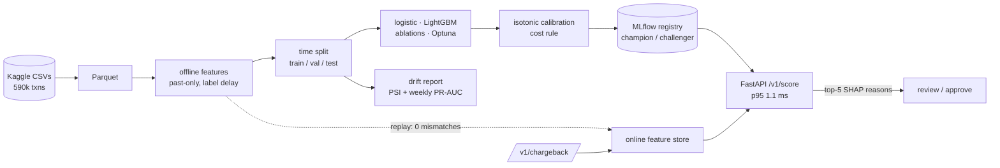

# Fraud Detection with MLOps

[](https://github.com/AnuragBhandary/Fraud-Detection-MLOps/actions/workflows/ci.yml)


Card-not-present fraud detection on **IEEE-CIS** (Vesta: 590,540 real e-commerce transactions,
3.5% fraud), built the way a production model has to work, not the way a Kaggle leaderboard
rewards:

* **Out-of-time evaluation:** train on days 1-119, tune on the next month, report on the month
  after. A random split would have claimed PR-AUC 0.87; the honest number is 0.64.
* **Features that only see the past,** including each customer's known fraud **with the label
  delay modelled**: a chargeback is only usable 30 days after the transaction.
* **Decisions in dollars:** review when expected loss beats the review cost, using calibrated
  probabilities. **Saves 68.5% of fraud cost** on the test month vs 34% for a 0.5 cutoff.
* **MLflow** tracking and registry with champion/challenger promotion; a **FastAPI** service
  that serves the champion with **top-5 SHAP reasons** per decision.
* **Online/offline parity proven:** the streaming feature store reproduces all 14.2M offline
  feature values exactly, and the HTTP API matches batch predictions on 5,000 of 5,000 rows.
* **Drift monitoring** (PSI per feature and score, weekly PR-AUC).

**Stack:** Python · LightGBM · scikit-learn · Optuna · MLflow · FastAPI · Polars · TreeSHAP ·
pytest · GitHub Actions

### Findings

| | |
|---|---|
| Champion (tuned LightGBM), test month | **PR-AUC 0.644**, ROC-AUC 0.936, 55% of fraud caught at 1% false-positive rate |
| vs logistic regression | +0.116 PR-AUC (95% CI +0.105 to +0.128) |
| What drives it | known fraud with a 30-day label delay: removing it costs 0.093 PR-AUC; velocity features add 0.002 |
| Label delay 7 / 30 / 60 / 90 days | test PR-AUC 0.707 / 0.637 / 0.607 / 0.573: faster chargebacks matter as much as modelling |
| Cost rule on the test month | $540k → $170k (**68.5% saved**), 9% of transactions reviewed, 85% of fraud dollars caught |
| Leakage | random split 0.873 vs time split 0.637 (37% overstated) |
| A feature that was a date | `account_start` had train/test PSI 1.84; replaced by an honest known-fraud feature |
| Linear baseline | StandardScaler halved test PR-AUC (0.17 vs 0.35 val); rank scaling fixed it (0.53) |
| Serving, 5,000 HTTP requests | p95 **1.1 ms**, or **8.2 ms** with SHAP reasons; 0 parity differences |
| Drift | score PSI under 0.11 every week while PR-AUC fell 0.81 → 0.56-0.67: monitor matured labels |
| Optuna | 30 trials, 20 pruned; +0.0005 val PR-AUC over hand-picked settings |
| Tests | 38, 95% coverage, mypy strict; CI on a synthetic dataset with the same schema |

Details: **[docs/RESULTS.md](docs/RESULTS.md)** · why each choice: **[docs/DESIGN.md](docs/DESIGN.md)**
· how to study and defend it: **[docs/INTERVIEW.md](docs/INTERVIEW.md)**

## Architecture



## Run it

Needs Python 3.12 and [uv](https://docs.astral.sh/uv/). macOS also needs `brew install libomp`
for LightGBM.

```bash
make install
# Accept the competition rules at kaggle.com/competitions/ieee-fraud-detection and save an API
# token to ~/.kaggle/access_token first.
make data           # 64 MB download
make all            # prepare, train (~15 min), leakage, label-delay, store, drift, bench
make serve          # API on :8000
make mlflow-ui      # runs and registry on :5050
make check          # lint + tests (synthetic data, no download needed)
```

```bash
curl -s localhost:8000/v1/score -H 'content-type: application/json' -d '{
  "TransactionID": 3577540, "TransactionDT": 15811131, "TransactionAmt": 249.0,
  "ProductCD": "W", "card1": 9500, "addr1": 204, "D1": 0, "P_emaildomain": "gmail.com"}'
```

returns the calibrated probability, `review` or `approve`, the expected loss, the model version
and the five features that pushed the score most.

## Layout

```
src/fraudops/
  features.py   offline features: row, history, known fraud (label delay), category codes
  online.py     the same features one event at a time, chargeback handling
  split.py      out-of-time split on whole days
  model.py      logistic, LightGBM, Optuna, calibration, the deployable bundle
  metrics.py    PR-AUC, recall at FPR, dollar cost, exact best threshold, bootstrap
  registry.py   MLflow pyfunc, champion/challenger promotion
  api.py        FastAPI scoring + chargeback endpoints
  drift.py      PSI and the weekly report
  bench.py      HTTP latency + parity benchmark
  pipeline.py   the steps behind `fraudops <step>`
  synth.py      synthetic IEEE-CIS-shaped data for tests and CI
```

Data: IEEE-CIS Fraud Detection (Vesta Corporation, Kaggle competition). It is not redistributed
here; download it under the competition rules.
